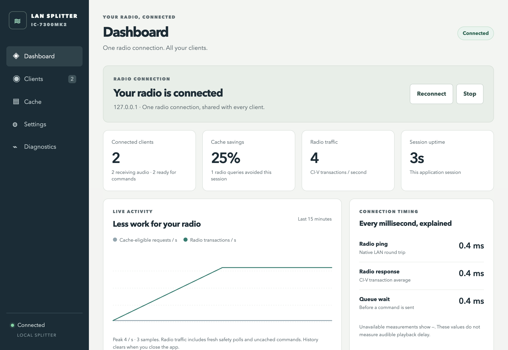

# IC-7300MK2 LAN Splitter

**[Download v0.8.1](https://github.com/s53zo/IC7300MK2_Lan_Splitter/releases/latest)** · [Installation guide](docs/interfaces.md)

Share one IC-7300MK2 LAN connection between multiple native Icom LAN clients.
The service connects to the radio once; clients connect to the service's address
instead of the radio's address. Audio, spectrum/waterfall and radio state are
shared. Clients share the actual receiver's tuning and settings.

This is a native Icom UDP service for local networks. It does not provide a web
UI, rigctld, TCI, or virtual serial/audio devices. The implemented audio format is
**LPCM mono, signed 16-bit little-endian, 48 kHz (codec 4)**. Other formats are
explicitly rejected. General native-client compatibility is the goal; see the
[validation matrix](docs/validation.md) for what has actually been tested.

## Install the app

**[Download v0.8.1 — installers and executables](https://github.com/s53zo/IC7300MK2_Lan_Splitter/releases/latest)**

| Computer | Download | Installation |
| --- | --- | --- |
| Windows x64 | [Windows installer](https://github.com/s53zo/IC7300MK2_Lan_Splitter/releases/download/v0.8.1/icom-lan-splitter-0.8.1-win32-x64-Setup.exe) | Run Setup, then open **Icom LAN Splitter** from Start |
| Mac Apple Silicon | [Mac download — M-series](https://github.com/s53zo/IC7300MK2_Lan_Splitter/releases/download/v0.8.1/icom-lan-splitter-0.8.1-darwin-arm64.dmg) | Drag the app into Applications |
| Mac Intel | [Mac download — Intel](https://github.com/s53zo/IC7300MK2_Lan_Splitter/releases/download/v0.8.1/icom-lan-splitter-0.8.1-darwin-x64.dmg) | Drag the app into Applications |
| Linux x64 | [Linux download — Intel/AMD](https://github.com/s53zo/IC7300MK2_Lan_Splitter/releases/download/v0.8.1/icom-lan-splitter-0.8.1-linux-x64.tar.gz) | Extract and run `./icom-lan-splitter` in a terminal |
| Linux ARM64 | [Linux download — ARM64](https://github.com/s53zo/IC7300MK2_Lan_Splitter/releases/download/v0.8.1/icom-lan-splitter-0.8.1-linux-arm64.tar.gz) | Extract and run `./icom-lan-splitter` in a terminal |

On first launch, enter the radio address, username and password, then choose
**Save & connect**. Later launches use your saved settings automatically. No
separate Node.js installation, configuration scripts or terminal commands are
needed on Windows/Mac. Linux opens a keyboard-operated interface.

The local interface must stay open: closing stops its splitter, with confirmation
during transmission. Dashboard, Clients, Cache, Settings and Diagnostics show
connection health and measured timing. Settings are saved locally; password
protection uses the OS vault on desktop and an explicitly unencrypted owner-only
file on Linux. History stays in memory for at most 15 minutes.

See **[installation and interface guide](docs/interfaces.md)** for setup,
configuration locations, credentials and keyboard controls. Downloads are
unsigned on Windows and ad-hoc signed, without notarization, on Mac; see
[release instructions](docs/releases.md). Drafts are visible to collaborators
until a maintainer publishes them. Optional headless bundles remain available.



## Headless/source usage

Install Node.js 22 or newer, then clone or download this repository. There are
no runtime package dependencies and no compile step. Run commands from the
repository directory.

Create a password file outside the repository using a text editor. It must
contain the radio password, optionally followed by one newline. Restrict it to
the service account (`chmod 600` on Linux/macOS, a user-only ACL on Windows).
Do not put the password in shell history, a command argument, or a committed file.

Linux/macOS:

```sh
export ICOM_RADIO_HOST=10.0.1.25
export ICOM_USERNAME=your-radio-user
export ICOM_PASSWORD_FILE="$HOME/.config/icom-splitter/password"
export ICOM_BIND_ADDRESS=192.168.1.20
node src/cli.js
```

Windows PowerShell:

```powershell
$env:ICOM_RADIO_HOST = '10.0.1.25'
$env:ICOM_USERNAME = 'your-radio-user'
$env:ICOM_PASSWORD_FILE = "$env:USERPROFILE\.config\icom-splitter\password"
$env:ICOM_BIND_ADDRESS = '192.168.1.20'
node .\src\cli.js
```

Replace `192.168.1.20` with the splitter computer's LAN IPv4 address. The default
listener is `127.0.0.1`, which accepts clients on the same computer only.
Use the radio's configured username and password in each client. Set the client
radio address to the splitter computer, and select LPCM mono 16-bit at 48 kHz.
The default UDP ports are `50001` control, `50002` CI-V, and `50003` audio.
Permit those inbound ports from the local network in the host firewall. For larger
client counts, raise `ICOM_MEMORY_BUDGET_MB`; its default conservative buffer
reservation admits roughly 18 clients. See the measured workloads in
[validation](docs/validation.md).

Stop a foreground process with **Ctrl+C**. Normal shutdown attempts TX release
before closing the upstream session. See [operations](docs/operations.md) for
configuration, service examples, and failure behavior.

## Shared control and transmission

During receive, commands execute in arrival order. Allowlisted client reads use
short caches (100 ms meters/state, 250 ms settings, 50 ms tuning) and combine
identical queued reads while preserving write order. Internal safety checks
always query the radio afresh. Set `ICOM_CACHE_ENABLED=0` to disable caching and
coalescing; see [cache configuration and status](docs/operations.md#client-read-cache).
This does not change the audio path or guarantee relief from audio dropouts. Multiple clients on one
computer, including clients using the same CI-V controller address, have separate
sessions and reply routing.

The first accepted transmit request owns TX. Other clients may continue reading
state and receiving available media, but their setting changes and competing
TX requests are rejected and discarded. Those changes never run after TX ends.
When the TX client disconnects or its heartbeat expires, the splitter clears
pending TX data, stops keying/PTT and checks that the radio reports receive
before permitting a new TX owner. Scope output remains enabled upstream even
when one client disables its local subscription.

A lost radio link or a killed process cannot guarantee immediate physical TX
release. Configure and verify a suitable radio-side transmission timeout.
Front-panel operation remains a physical radio operation; the service does not
create independent receivers or arbitrate human controls on the radio itself.

Physical MK2 checks with two clients have passed for shared tuning, audio/scope,
token renewal and five PTT handover cycles. These are protocol/state checks; RF
power and audio quality were not measured. See [hardware evidence](docs/validation.md#physical-mk2-record--2026-11-08).

## Development and evidence

```sh
npm ci
npm run lint
npm run check
npm test
npm pack --dry-run
npm run test:capacity -- 16 2000
```

Development dependencies are used only for linting; the running service has no
package dependencies. The capacity command uses a synthetic radio on loopback. It measures the specified
workload, not maximum LAN capacity or RF quality. Source checkouts include the
test fixtures required by that command.

- [Architecture and protocol behavior](docs/architecture.md)
- [Configuration, service installation, and troubleshooting](docs/operations.md)
- [Validation and interoperability](docs/validation.md)
- [Manuals, related projects, and source provenance](docs/research.md)

AGPL-3.0-only; see [LICENSE](LICENSE) and [NOTICE.md](NOTICE.md).
