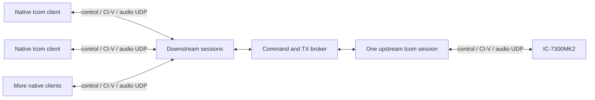

# Architecture

“One connection” means one logical native Icom session, comprising three UDP
channels. Adding a downstream client never opens another upstream radio session.
The three listeners and each client's stream state are owned by `NativeServer`;
`Broker` schedules commands and owns TX; `IcomSession` maintains the upstream
radio association. `Splitter` composes their lifecycle.

## Session virtualization

Each downstream control, CI-V and audio stream has its own IDs, sequence space,
keepalive state, replay history and bounded reorder state. Control performs
presence/ready negotiation, credential login, token exchange, capabilities and
media grants. The service emits both the native 80-byte status grant and the
144-byte connection-information grant expected by the local client references.

Media streams are matched to their authenticated control session using the
source IPv4 address **and the client ports supplied in its stream request**.
An IP-only match would confuse multiple programs on one host. Endpoint collisions
are rejected instead of stealing an existing association. This design targets a
local network; source-port-changing NAT traversal is outside the first version.

The service advertises only the implemented 48-kHz mono LPCM format. Negotiation
of unsupported codecs/rates fails explicitly. It does not advertise wfview's
Opus extension or resample one client's audio by changing the upstream format.

## Commands, replies and state

CI-V ACK/NG messages have no request identifier. The broker serializes upstream
transactions, writes a single reserved controller address upstream, and restores
the requesting client's controller address on the private reply. Scope frames and
unsolicited radio state are distributed to all clients rather than completing an
unrelated pending request. Frequency/mode changes produce shared state updates.
A command timeout resets the upstream association so a late ACK cannot confirm a
later client's transaction. Old queued writes and media are discarded on loss.

The physical radio has one shared configuration. Scope span/mode, audio routing,
mode and frequency changes affect every client. The splitter does not provide
per-client virtual tuning, spectrum spans, or AF/IF selections. The broker enables
scope and waveform output (`27 10`/`27 11`) upstream at startup/reconnect. Client
subscription OFF requests are handled locally, so one client cannot stop the
radio's shared scope output. Scope frames are rewritten to broadcast destination
`00`, allowing clients with different controller addresses to receive them.

## TX leases

The broker reserves TX for an accepted PTT, CW, supported automatic-TX or VOX
operation. It checks permission both when a command arrives and when it would
execute. Other clients' mutations and TX audio are discarded during that lease;
reads remain eligible. Lease-ending cleanup bypasses queued nonessential work,
invalidates replayable keying/audio and confirms the radio's TX state is receive.
CW completion uses a conservative deadline of 6 seconds per input character
at the slowest supported 6 WPM, followed by three observed receive polls. A client
may explicitly stop sooner. Voice-memory playback retains ownership until an
explicit stop or disconnect because silence does not prove a repeat loop ended.
Tuner completion uses tuner status; cleanup includes its specific stop command.

On startup/reconnect, the broker attempts CW stop, cleanup of remembered TX
initiators, PTT off and a receive-state query before accepting ordinary client
work. It then enables scope and waveform output. It does not retune or change the
mode/modulation route to make a client work. Configure radio LAN modulation and
AF/IF routing as appropriate for the clients. Readiness is a protocol check, not
proof that RF output is physically absent.

Local microphone, keyer, VOX and front-panel operations are outside software
ownership. TX-state polling blocks remote mutations when unowned TX is observed,
but cannot provide atomic interlocking with physical controls. For a predictable
shared station, avoid simultaneous physical and remote transmission control.

## Bounds and failure limits

The server uses a memory budget to admit sessions, rather than a licensed or
hardcoded client count. Replay, reorder and pending-send buffers are bounded per
stream. The broker also bounds queued commands globally and per client; overload
rejects commands rather than accumulating an unbounded backlog. Capacity depends
on the chosen budgets, packet sizes, client behavior, CPU and network bandwidth.

At a TX lease boundary, buffered downstream CI-V/audio and partial frames are
discarded. The server advances a seen-sequence watermark through buffered
reordered packets so a late gap-fill cannot revive already observed old TX data.
The native wire format has no TX-epoch identifier: a packet never previously
seen, delayed until a later lease in the same association, cannot always be
identified as old. Reconnects do create fresh associations/IDs.

A client timeout detects a missing heartbeat; unplugging a cable is not detected
instantaneously. A disconnected upstream radio cannot receive stop commands.
Likewise, process termination without graceful shutdown cannot execute cleanup.
Use radio-side timeouts and operational interlocks appropriate to the station.

See [validation](validation.md) for tested cases and gaps, and
[research](research.md) for the distinction between the official inner CI-V
commands and the reverse-engineered native LAN envelope.

Owner stop requests bypass ordinary queue saturation by cancelling that owner's
queued work and taking a bounded priority position after the in-flight reply.
A PTT-off request immediately retires queued media and blocks audio rearming; a
late PTT-on acknowledgement cannot undo that stop. Reply correlation still
requires consuming the current transaction or resetting on timeout.

Cleanup is mode-aware: it releases PTT, queries the actual mode, and requires CW
keyer stop only in CW/CW-R. The physical MK2 rejects CW-stop in other modes. A
failed mode read or rejected stop in CW prevents readiness/handover instead of
being treated as a successful release. The operator's mode is not changed.
